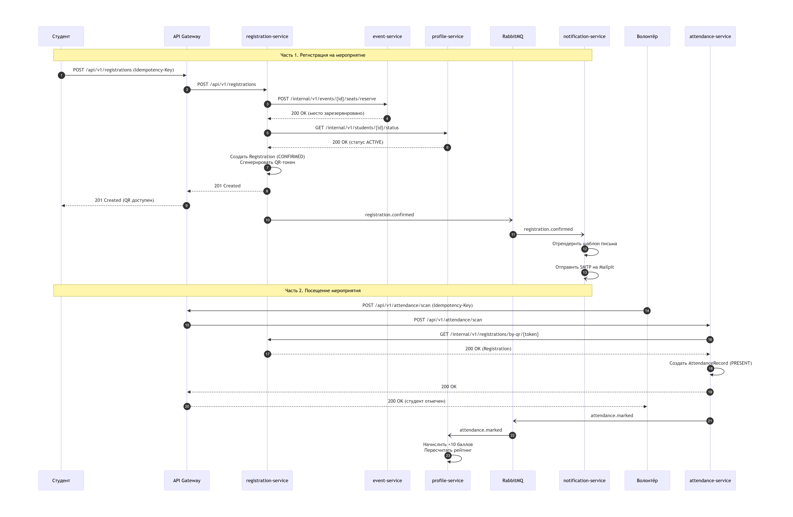
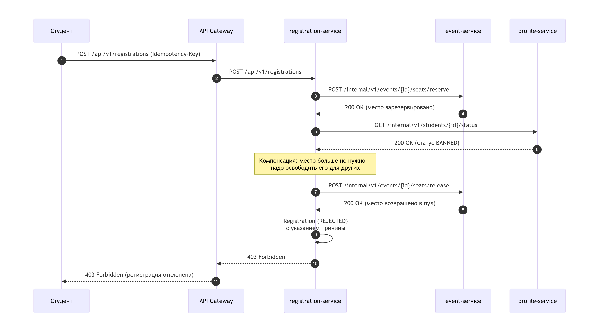

# DSTU Events – микросервисная система управления мероприятиями

## Содержание

1. [Анализ предметной области](#1-анализ-предметной-области)
2. [Карточки сервисов](#2-карточки-сервисов)
3. [Выбор ПО](#3-выбор-по)
4. [Схемы взаимодействий](#4-схемы-взаимодействий)
5. [Контракты API](#5-контракты-api)

---

## 1. Анализ предметной области

### 1.1. Описание системы

**DSTU Events** – единая платформа для управления мероприятиями Донского государственного технического университета. Система позволяет администраторам создавать события с ограниченным количеством мест, а студентам – записываться на них и получать персональные QR-коды для прохода. На входе волонтёры сканируют QR-коды через мобильную версию сайта, система фиксирует посещение и автоматически начисляет баллы в рейтинг студента. Рейтинг в дальнейшем используется для поощрений и распределения материальных благ (например, мест в общежитии).

### 1.2. Акторы

#### Пользователи системы

| Актор | Описание |
|-------|----------|
| **Студент** | Авторизованный пользователь. Просматривает афишу, записывается на мероприятия, получает QR-код, следит за рейтингом. |
| **Администратор** | Сотрудник деканата или студсовета. Создаёт, редактирует и отменяет мероприятия, задаёт лимиты мест. |
| **Волонтёр** | Работник на входе. Сканирует QR-коды через мобильную версию сайта, отмечает посещение или неявку. |

#### Внешние системы

| Система | Назначение |
|---------|-----------|
| **Keycloak** | Аутентификация и авторизация (OAuth 2.0 / OIDC). Выдаёт JWT-токены с ролями `student`, `admin`, `volunteer`. |
| **SMTP-сервер** | Отправка email-уведомлений. В dev-окружении используется **Mailpit** (перехват писем в веб-интерфейсе). |

Инфраструктура (не акторы): **API Gateway (Kong)** – единая точка входа, маршрутизация и проверка токенов.

### 1.3. Пользовательские сценарии

1. **Как студент**, я хочу открыть афишу и отфильтровать мероприятия по типу и дате, чтобы найти интересные события.
2. **Как студент**, я хочу записаться на мероприятие с ограниченным количеством мест, чтобы гарантированно попасть на него.
3. **Как студент**, я хочу получить QR-код сразу после регистрации, чтобы пройти без бумажного билета.
4. **Как студент**, я хочу встать в лист ожидания, если места закончились, чтобы получить шанс при чьей-то отмене.
5. **Как студент**, я хочу видеть свой рейтинг и историю посещений, чтобы понимать, за что я получил баллы.
6. **Как администратор**, я хочу создать мероприятие с лимитом мест, чтобы контролировать посещаемость.
7. **Как администратор**, я хочу отменить мероприятие, чтобы все записавшиеся получили уведомление.
8. **Как волонтёр**, я хочу отсканировать QR-код на входе, чтобы засчитать посещение и запустить начисление баллов.

### 1.4. Доменные события

Упрощённый Event Storming – события сгруппированы вокруг будущих контекстов.

#### Мероприятия
- `EventCreated` – мероприятие создано (черновик)
- `EventPublished` – мероприятие опубликовано в афише
- `EventCancelled` – мероприятие отменено администратором
- `EventCompleted` – мероприятие завершено, баллы начислены

#### Регистрация
- `RegistrationCreated` – заявка создана
- `SeatReserved` – место зарезервировано на 15 минут
- `RegistrationConfirmed` – регистрация подтверждена, QR выдан
- `RegistrationCancelled` – регистрация отменена
- `StudentWaitlisted` – студент в листе ожидания
- `WaitlistPromoted` – студент приглашён из листа ожидания
- `RegistrationExpired` – время резерва истекло

#### Посещаемость
- `QrScanned` – QR-код отсканирован
- `AttendanceMarked` – посещение засчитано
- `NoShowRecorded` – неявка зафиксирована

#### Профиль и рейтинг
- `PointsAwarded` – баллы начислены
- `PointsDeducted` – баллы списаны

### 1.5. Ограниченные контексты и глоссарии

Пять бизнес-контекстов. Один контекст = один сервис (стартовая гипотеза).

#### 1. Event Context (мероприятия)

**Глоссарий:**

- **Мероприятие** — событие в каталоге. Имеет название, описание, тип (конференция / спортивное / культурное / день открытых дверей), дату, место, лимит мест и статус:
  - `DRAFT` (черновик) — создано администратором, но ещё не видно студентам.
  - `PUBLISHED` (опубликовано) — отображается в афише, открыта регистрация.
  - `CANCELLED` (отменено) — мероприятие отменено, регистрации аннулируются.
  - `COMPLETED` (завершено) — прошло, регистрация закрыта, баллы начислены.
- **Аудитория** — физическое место проведения: корпус, номер, вместимость. Справочник, общий для всех мероприятий.
- **Лимит мест** — максимальное количество студентов, которое может зарегистрироваться. Нельзя уменьшить ниже числа уже зарезервированных мест.
- **Расписание** — набор временных слотов мероприятия: регистрация 10:00–10:30, начало 10:30, перерыв 12:00–12:30 и т.д.

#### 2. Registration Context (регистрация)

**Глоссарий:**

- **Регистрация** — заявка студента на мероприятие. Статусы:
  - `PENDING` (ожидает подтверждения) — место удерживается 15 минут, регистрация не подтверждена.
  - `CONFIRMED` (подтверждена) — QR-код выдан, студент может проходить.
  - `CANCELLED` (отменена) — студент отменил сам или мероприятие отменено администратором.
  - `EXPIRED` (просрочена) — не подтверждена за 15 минут, место освобождено.
  - `WAITLISTED` (в листе ожидания) — мест не было, студент поставлен в очередь.
  - `REJECTED` (отклонена) — не прошла проверку (например, студент заблокирован).
- **Бронь места** — временное удержание места за студентом на 15 минут. Хранится в Redis как ключ с ограниченным временем жизни (TTL — Time To Live, «время до удаления»). По истечении этого срока Redis автоматически удаляет ключ, и место возвращается в общий пул — если студент за 15 минут не подтвердил регистрацию, оно освобождается без вмешательства человека.
- **QR-токен** — уникальная строка, привязанная к регистрации. Кодируется в QR-код. Живёт до конца мероприятия.
- **Лист ожидания** — очередь студентов, которым не хватило мест. При освобождении места первый в очереди получает уведомление и 2 часа на подтверждение.

#### 3. Attendance Context (посещаемость)

**Глоссарий:**

- **Отметка** — запись о посещении или неявке. Статусы:
  - `PRESENT` (присутствовал) — пришёл, QR отсканирован, баллы начисляются.
  - `NO_SHOW` (не явился) — был зарегистрирован, но не пришёл; баллы списываются.
  - `LATE` (опоздал) — пришёл после начала; баллы могут начисляться частично.
- **Сканирование** — считывание QR-кода волонтёром через мобильную версию сайта; каждое сканирование пишется в журнал `ScanLog` для разбора спорных ситуаций.
- **Неявка** — студент зарегистрирован, но не пришёл; фиксируется волонтёром вручную или автоматически через 30 минут после начала.

#### 4. Profile Context (профиль и рейтинг)

**Глоссарий:**

- **Профиль** — данные студента: ФИО, группа, факультет и статус:
  - `ACTIVE` (активен) — обычный студент, может регистрироваться и получать баллы.
  - `BANNED` (заблокирован) — лишён права регистрации; заявки отклоняются со статусом `REJECTED`.
  - `GRADUATED` (выпустился) — окончил вуз, регистрация закрыта, но рейтинг доступен для просмотра.
- **Баллы** — числовое значение за посещение: +10 за конференцию, +5 за спортивное, −20 за неявку.
- **Транзакция баллов** — запись о начислении или списании; append-only (только добавление) — не редактируется и не удаляется для аудита.
- **Рейтинг** — агрегат по сумме баллов: общий, по факультету или по группе.

#### 5. Notification Context (уведомления)

**Глоссарий:**

- **Шаблон** — заготовка письма с переменными вида `{{studentName}}`, `{{eventTitle}}`, `{{qrLink}}`, которые при отправке заменяются на реальные данные студента и мероприятия. Версионируется.
- **Канал** — способ доставки: `EMAIL` (электронная почта), `PUSH` (пуш-уведомления), `SMS` (СМС).
- **Лог отправки** — запись о каждой попытке отправки: получатель, идентификатор шаблона, статус (`SENT` — отправлено, `FAILED` — ошибка, `RETRY` — повторная попытка), время.

### 1.6. Иллюстрация: почему контексты важны

Одно и то же слово в разных контекстах означает **разное**:

| Термин | В Event | В Registration | В Attendance | В Notification |
|--------|---------|----------------|--------------|----------------|
| **Мероприятие** | полная сущность (название, дата, место) | лимит мест и статус | ID и название | название в шаблоне письма |
| **Регистрация** | – | сущность с QR-кодом и статусом | ID для сверки | данные для подстановки в письмо |
| **Баллы** | – | – | – | – |

---

## 2. Карточки сервисов

### 2.1. Сводная таблица

| Сервис | Ответственность | Владеет данными | Ключевые зависимости |
|--------|-----------------|-----------------|----------------------|
| `event-service` | создание и публикация мероприятий, резервирование мест | Event, Venue, SeatLimit | Redis (кэш), PostgreSQL, RabbitMQ |
| `registration-service` | запись на мероприятия, waitlist, выдача QR | Registration, WaitlistEntry, QrToken | PostgreSQL, Redis (TTL), event-service (sync), profile-service (sync) |
| `attendance-service` | сканирование QR, фиксация посещений | AttendanceRecord, ScanLog | PostgreSQL, Redis, registration-service (sync), RabbitMQ |
| `profile-service` | профиль студента, баллы, рейтинг | StudentProfile, PointsTransaction | PostgreSQL, RabbitMQ |
| `notification-service` | отправка email-уведомлений | NotificationLog, Template | MongoDB, SMTP (Mailpit), RabbitMQ |

### 2.2. Карточки сервисов

#### event-service

| Поле | Значение |
|------|----------|
| **Название** | `event-service` |
| **Ответственность** | Ведёт жизненный цикл мероприятий: создание, публикация, редактирование, отмена. Отдаёт афишу и расписание. Управляет резервированием мест по внутреннему запросу от registration-service. |
| **Владеет данными** | `Event` (мероприятие), `Venue` (аудитория), `SeatLimit` (лимит мест), `Schedule` (расписание) — единственный источник истины по этим сущностям. |
| **Предоставляет (sync)** | **Публичные:** • `GET /api/v1/events` — афиша с фильтрами по типу и датам, с пагинацией • `GET /api/v1/events/{id}` — карточка мероприятия • `POST /api/v1/events` — создать мероприятие (роль `admin`) • `PATCH /api/v1/events/{id}` — отредактировать мероприятие (роль `admin`) • `DELETE /api/v1/events/{id}` — отменить мероприятие (роль `admin`), публикует `event.cancelled` **Внутренние:** • `POST /internal/v1/events/{id}/seats/reserve` — зарезервировать место (вызывает registration-service) • `POST /internal/v1/events/{id}/seats/release` — освободить место (компенсация, вызывает registration-service) |
| **Публикует события** | `event.published`, `event.cancelled`, `event.completed` |
| **Зависит от (sync)** | Синхронных вызовов других сервисов не делает. JWT-токен проверяет API Gateway. На события не подписан. |
| **НФТ** | Высокая нагрузка на чтение (афишу открывают массово в начале семестра), запись редкая — пишет только администратор. Критичность высокая: если афиша не открывается, система бесполезна. Требования к задержке чтения — низкая, обеспечивается кэшем в Redis. |
| **Обоснование границы** | 1) Афишу читают в 100 раз чаще, чем регистрируются → сервис масштабируется отдельно под чтение. 2) Единственный владелец данных о мероприятиях и лимитах. 3) Логика резервирования мест тесно связана с самим мероприятием — выносить её в отдельный сервис означало бы искусственное дробление. |

#### registration-service

| Поле | Значение |
|------|----------|
| **Название** | `registration-service` |
| **Ответственность** | Записывает студентов на мероприятия, резервирует места, ведёт лист ожидания, генерирует QR-коды. Ядро системы — здесь сосредоточена вся конкурентная логика за места. |
| **Владеет данными** | `Registration` (регистрация), `WaitlistEntry` (запись в листе ожидания), `QrToken` (QR-токен), `SeatReservation` (бронь места). |
| **Предоставляет (sync)** | **Публичные:** • `POST /api/v1/registrations` — записаться на мероприятие (требует `Idempotency-Key`); если мест нет — ставит в лист ожидания • `GET /api/v1/registrations/my` — список своих регистраций с пагинацией • `DELETE /api/v1/registrations/{id}` — отменить свою регистрацию, освободить место **Внутренние:** • `GET /internal/v1/registrations/by-qr/{token}` — найти регистрацию по QR-токену (вызывает attendance-service) • `POST /internal/v1/registrations/{id}/confirm` — подтвердить регистрацию (`PENDING` → `CONFIRMED`) |
| **Публикует события** | `registration.confirmed`, `registration.cancelled`, `registration.waitlisted`, `registration.waitlist_promoted` |
| **Зависит от (sync)** | **Синхронно вызывает:** `event-service` (резерв/освобождение места), `profile-service` (проверка, что студент в статусе `ACTIVE`). **Подписан на событие:** `event.cancelled` — чтобы массово отменить регистрации при отмене мероприятия. |
| **НФТ** | Пиковая нагрузка в момент открытия регистрации на популярное мероприятие — все ломятся одновременно. Критичность высокая. Требования к задержке — низкая. Обязательна идемпотентность по `Idempotency-Key` — иначе двойной клик пользователя создаст две регистрации. |
| **Обоснование границы** | 1) Самая сложная логика в системе: конкурентный доступ к местам, лист ожидания, сага с компенсациями. 2) Свои нефункциональные требования (пиковая нагрузка при открытии регистрации), отличные от event-service. 3) Использует распределённую блокировку в Redis, которая не нужна другим сервисам. |

#### attendance-service

| Поле | Значение |
|------|----------|
| **Название** | `attendance-service` |
| **Ответственность** | Принимает QR-коды от волонтёров через мобильную версию сайта, валидирует их через registration-service, фиксирует посещение или неявку. |
| **Владеет данными** | `AttendanceRecord` (отметка о посещении), `ScanLog` (журнал сканирований). |
| **Предоставляет (sync)** | **Публичные:** • `POST /api/v1/attendance/scan` — отсканировать QR на входе, зафиксировать посещение (требует `Idempotency-Key`) • `POST /api/v1/attendance/no-show` — отметить неявку студента **Внутренние:** • `GET /internal/v1/attendance/by-event/{eventId}` — список всех отметок по мероприятию (для админки и отладки) |
| **Публикует события** | `attendance.marked`, `attendance.no_show` |
| **Зависит от (sync)** | **Синхронно вызывает:** `registration-service` (получить регистрацию по QR-токену). Больше ни от кого не зависит. |
| **НФТ** | Пиковая нагрузка в первые минуты мероприятия — волонтёры массово сканируют QR. Критичность средняя: при сбое волонтёр может отметить посещение вручную по бумажному списку. Требования к задержке — умеренная. |
| **Обоснование границы** | 1) Разные нефункциональные требования: регистрация получает пик запросов заранее, attendance — в момент старта мероприятия. 2) Может буферизовать сканы локально при недоступности registration-service — то есть работать автономно. 3) Логика сканирования QR с мобильного клиента — отдельная техническая задача, не связанная с регистрацией. |

#### profile-service

| Поле | Значение |
|------|----------|
| **Название** | `profile-service` |
| **Ответственность** | Хранит профиль студента, начисляет и списывает баллы, считает рейтинг, ведёт историю достижений. |
| **Владеет данными** | `StudentProfile` (профиль студента), `PointsTransaction` (транзакции баллов), `Achievement` (достижения). |
| **Предоставляет (sync)** | **Публичные:** • `GET /api/v1/profile/me` — мой профиль (ФИО, группа, статус, рейтинг) • `GET /api/v1/profile/me/points` — история начислений и списаний баллов с пагинацией **Внутренние:** • `GET /internal/v1/students/{id}/status` — проверить статус студента (`ACTIVE` / `BANNED` / `GRADUATED`), вызывает registration-service |
| **Публикует события** | `points.awarded`, `points.deducted` (задел на будущее — например, для рассылки поздравлений). |
| **Зависит от (sync)** | **Подписан на события:** `attendance.marked` (начислить баллы), `attendance.no_show` (списать баллы). Синхронных вызовов других сервисов не делает. |
| **НФТ** | Умеренная нагрузка на чтение и низкая на запись — основная работа идёт через события. Критичность высокая: баллы нельзя терять. Каждая транзакция с баллами логируется (журнал append-only — «только добавление»). |
| **Обоснование границы** | 1) Свои требования к аудиту — каждая операция с баллами должна быть восстановима. 2) Рейтинг — это отдельная бизнес-сущность, а не просто поле в профиле; он считается по своим правилам. 3) Может масштабироваться независимо от регистрации. |

#### notification-service

| Поле | Значение |
|------|----------|
| **Название** | `notification-service` |
| **Ответственность** | Отправляет email-письма по событиям: подтверждение регистрации с QR-кодом, отмена, приглашение из листа ожидания, анонс нового мероприятия. |
| **Владеет данными** | `NotificationLog` (лог отправок), `Template` (шаблон письма), `Channel` (канал доставки). |
| **Предоставляет (sync)** | **Внутренние:** • `POST /internal/v1/notifications/send` — отправить письмо вручную (админская функция, требует `Idempotency-Key`) • `GET /internal/v1/notifications` — журнал отправок с фильтрами (для поддержки и отладки) • `GET /internal/v1/notifications/{id}` — детали конкретной отправки • `POST /internal/v1/notifications/{id}/retry` — повторить отправку вручную, если авторетраи исчерпаны |
| **Публикует события** | Событий не публикует, только потребляет. |
| **Зависит от (sync)** | **Подписан на события:** `registration.confirmed`, `registration.cancelled`, `registration.waitlisted`, `registration.waitlist_promoted`, `event.published`, `event.cancelled`. **Внешняя система:** SMTP-сервер (в учебной конфигурации — Mailpit). |
| **НФТ** | Умеренная нагрузка на отправку. Критичность низкая: падение уведомлений не ломает основной сценарий — студент всё равно записан, QR-код можно посмотреть в личном кабинете. Требования к задержке — мягкие, доставка полностью асинхронная. |
| **Обоснование границы** | 1) Падение уведомлений не должно ломать регистрацию — сервис вынесен и полностью асинхронный. 2) Разные типы писем имеют разную структуру → используется гибкая схема данных (MongoDB). 3) Может масштабироваться независимо от остальных сервисов — например, при массовой рассылке. |

### 2.3. Отвергнутые варианты разбиения

#### Вариант А: объединить `registration-service` и `attendance-service`

**Рассматривали:** один сервис `registration-attendance`, потому что оба работают с одной и той же связкой «студент + мероприятие».

**Отказались по трём причинам:**

1. **Разные профили нагрузки.** Регистрация пикует в момент открытия — все ломятся одновременно. Посещаемость пикует в первые минуты мероприятия — волонтёры массово сканируют QR. Если объединить, придётся масштабировать оба сценария одновременно, что неоправданно дорого.
2. **Разная устойчивость к сбоям.** attendance-service может буферизовать сканы локально при недоступности registration-service. В монолите падение одного сценария тянет за собой другой.
3. **Разные требования к аудиту.** Для attendance важен журнал сканирований, для регистрации — идемпотентность по ключу. Это разные технические решения.

#### Вариант Б: выделить отдельный `user-service`

**Рассматривали:** собственный сервис пользователей (регистрация, профиль, адреса).

**Отказались по трём причинам:**

1. **Keycloak уже закрывает аутентификацию** (OAuth 2.0 / OpenID Connect) — писать свой сервис было бы дублированием.
2. **Классическая ошибка «сервис на таблицу»** — CRUD-обёртка без бизнес-логики.
3. **То, что действительно важно про студента** (баллы, рейтинг, статус), живёт в profile-service — отдельный user-service не дал бы ценности.

#### Вариант В: объединить `event-service` и `registration-service`

**Рассматривали:** один сервис под предлогом «оба про мероприятия».

**Отказались по трём причинам:**

1. **Афишу читают в 100 раз чаще, чем регистрируются.** Если слить, придётся масштабировать всю систему под чтение — включая транзакционную логику регистрации.
2. **Разные модели данных.** Для event-service сущности «регистрация» не существует, а для registration-service «мероприятие» — это в основном ID, лимит мест и статус. Тащить транзакции с резервированием в каталог неправильно.
3. **Разные права и источники нагрузки.** В event-service пишет только администратор, в registration-service — все студенты.

#### Вариант Г: слить `notification-service` с `registration-service`

**Рассматривали:** один сервис «регистрация + уведомления».

**Отказались, потому что:** падение отправки писем не должно ломать регистрацию. Если письмо не уйдёт, студент всё равно записан, у него есть QR в личном кабинете. Асинхронная отправка через RabbitMQ даёт отказоустойчивость и повторные попытки без потери основного сценария.

#### Вариант Д: объединить `profile-service` и `event-service`

**Рассматривали:** один сервис «мероприятия + профили».

**Отказались, потому что:** это две разные предметные области. В event-service — контент (что, где, когда), в profile-service — человек (кто, сколько баллов). Общего между ними только идентификатор студента и идентификатор мероприятия. Сливать их — значит получить распределённый монолит.

---

## 3. Выбор ПО

### 3.1. Таблица выбранных компонентов

| Компонент | Какие сервисы используют | Обоснование выбора |
|-----------|--------------------------|--------------------|
| **PostgreSQL** | event, registration, attendance, profile | Строгая схема, транзакции. Атомарное резервирование мест и работа с листом ожидания в registration-service, append-only журнал баллов в profile-service, связи «мероприятие → аудитория → расписание» в event-service, уникальность отметок «студент + мероприятие» в attendance-service. У каждого сервиса своя БД — общих таблиц нет. |
| **MongoDB** | notification | Разные типы писем имеют разную структуру, документ читается целиком (шаблон по ID, запись лога). Реляционная схема потребовала бы JSON-поля или отдельные таблицы под каждый тип — документная модель здесь уместнее. |
| **Redis** | event, registration, attendance | Три сценария: кэш афиши в event-service (снимает нагрузку с PostgreSQL), распределённая блокировка и брони с TTL 15 минут в registration-service, проверка «QR уже сканировался» в attendance-service. Везде — короткоживущие данные и высокая скорость доступа. |
| **RabbitMQ** | все сервисы | Поток событий небольшой, нужна надёжная доставка конкретному получателю с повторными попытками через Dead Letter Queue. Kafka избыточна — она под миллионы событий и повторное чтение несколькими потребителями. |
| **Kong (API Gateway)** | все сервисы | Единая точка входа с маршрутизацией по путям, проверкой JWT от Keycloak и rate limiting. Выбран вместо Nginx (не нужны Lua-скрипты) и Spring Cloud Gateway (не тянем JVM ради одного компонента). |
| **Keycloak** | Gateway + все сервисы | Готовый OpenID Connect: логин, токены, три роли — student, admin, volunteer. Свой сервис пользователей не пишется. |
| **Mailpit** (локальный SMTP) | notification (**dev**) | В учебной сети нельзя отправлять через внешние SMTP: без SPF/DKIM/DMARC письма уйдут в спам, а 25-й порт часто блокируется провайдером. Mailpit принимает SMTP на 1025 и показывает письма в веб-интерфейсе — notification-service работает через обычный SMTP и не знает про подмену. Адрес сервера меняется одной переменной окружения. |

### 3.2. Отвергнутые варианты

| Что рассматривали | Почему отказались |
|-------------------|-------------------|
| **Kafka** | Избыточна: поток событий маленький, нужна доставка конкретному получателю, а не повторное чтение несколькими потребителями. |
| **Elasticsearch** | Мероприятий десятки-сотни в год, полнотекстовый поиск не нужен, хватает SQL-фильтров. |
| **MinIO / S3** | Файлов в системе нет, добавим отдельным сервисом, если появятся. |
| **Nginx** | Для JWT и rate limiting пришлось бы писать Lua-скрипты, Kong умеет это из коробки. |
| **Spring Cloud Gateway** | Тянуть JVM ради одного компонента при Python-стеке смысла нет. |

### 3.3. Итоговая схема инфраструктуры

6 экземпляров БД (4 PostgreSQL + MongoDB + Redis), RabbitMQ, Kong, Keycloak и Mailpit — всё поднимается в Docker Compose. Каждый бизнес-сервис владеет своей БД, общих таблиц нет. Связь — REST для синхронных операций и RabbitMQ для событий.

---

## 4. Схемы взаимодействий

### 4.1. Архитектурная схема

*Сплошные стрелки – синхронные вызовы, пунктирные – асинхронные события через RabbitMQ.*

### 4.2. Диаграммы последовательности

#### Успешный сценарий (Регистрация и посещение)

#### Сбой (Студент забанен — компенсация)

### 4.3. Таблица взаимодействий

#### Синхронные вызовы – клиент через Gateway (public API)

| № | Инициатор → Получатель | Эндпоинт | Назначение |
|---|------------------------|----------|------------|
| 1 | client → Gateway → event | `GET /api/v1/events` | Афиша |
| 2 | client → Gateway → registration | `POST /api/v1/registrations` | Записаться на мероприятие |
| 3 | volunteer → Gateway → attendance | `POST /api/v1/attendance/scan` | Сканировать QR на входе |

#### Синхронные вызовы – сервис-к-сервису (internal)

| № | Инициатор → Получатель | Эндпоинт | Назначение |
|---|------------------------|----------|------------|
| 4 | registration → event | `POST /internal/v1/events/{id}/seats/reserve` | Резерв места |
| 5 | registration → profile | `GET /internal/v1/students/{id}/status` | Проверка статуса студента |
| 6 | attendance → registration | `GET /internal/v1/registrations/by-qr/{token}` | Валидация QR |

#### Асинхронные – публикация событий (RabbitMQ)

| № | Издатель | Событие | Подписчики |
|---|----------|---------|------------|
| 7 | registration | `registration.confirmed` | notification |
| 8 | attendance | `attendance.marked` | profile |
| 9 | event | `event.cancelled` | registration, notification |

#### Сага регистрации – компенсации при сбоях

| Сбой | Компенсирующее действие |
|------|-------------------------|
| Нет мест | Студент переводится в `WAITLISTED`, публикуется `registration.waitlisted` |
| Студент забанен | registration вызывает `POST /seats/release`, статус `REJECTED` |
| event-service недоступен | Circuit Breaker, клиенту 503, данные не сохраняются |
| Notification упал | Retry через Dead Letter Queue, регистрация не ломается |
| Студент не пришёл | attendance публикует `attendance.no_show`, profile списывает баллы |
| Двойное сканирование QR | attendance проверяет `eventId` + `token` в Redis, повтор игнорируется |

---

## 5. Контракты API

### 5.1. Спецификации API

| Сервис | Спецификация | Краткое описание |
|--------|--------------|------------------|
| event-service | [event-service.yaml](api/event-service.yaml) | Каталог мероприятий, резервирование и освобождение мест |
| registration-service | [registration-service.yaml](api/registration-service.yaml) | Регистрация на мероприятия, лист ожидания, генерация QR-кодов |
| attendance-service | [attendance-service.yaml](api/attendance-service.yaml) | Сканирование QR на входе, фиксация посещений и неявок |
| profile-service | [profile-service.yaml](api/profile-service.yaml) | Профиль студента, статус, баллы, рейтинг |
| notification-service | [notification-service.yaml](api/notification-service.yaml) | Отправка email-уведомлений, журнал отправок |

### 5.2. Асинхронные события
Спецификация событий: [events.yaml](api/events.yaml) (AsyncAPI 2.6.0).

| Событие | Топик | Издатель | Подписчики | Ссылка на схему |
|---------|-------|----------|------------|-----------------|
| `registration.confirmed` | `registrations` | registration | notification | `#/components/messages/RegistrationConfirmed` |
| `registration.cancelled` | `registrations` | registration | notification | `#/components/messages/RegistrationCancelled` |
| `registration.waitlisted` | `registrations` | registration | notification | `#/components/messages/RegistrationWaitlisted` |
| `registration.waitlist_promoted` | `registrations` | registration | notification | `#/components/messages/WaitlistPromoted` |
| `attendance.marked` | `attendance` | attendance | profile | `#/components/messages/AttendanceMarked` |
| `attendance.no_show` | `attendance` | attendance | profile | `#/components/messages/AttendanceNoShow` |
| `event.published` | `events` | event | notification | `#/components/messages/EventPublished` |
| `event.cancelled` | `events` | event | registration, notification | `#/components/messages/EventCancelled` |
